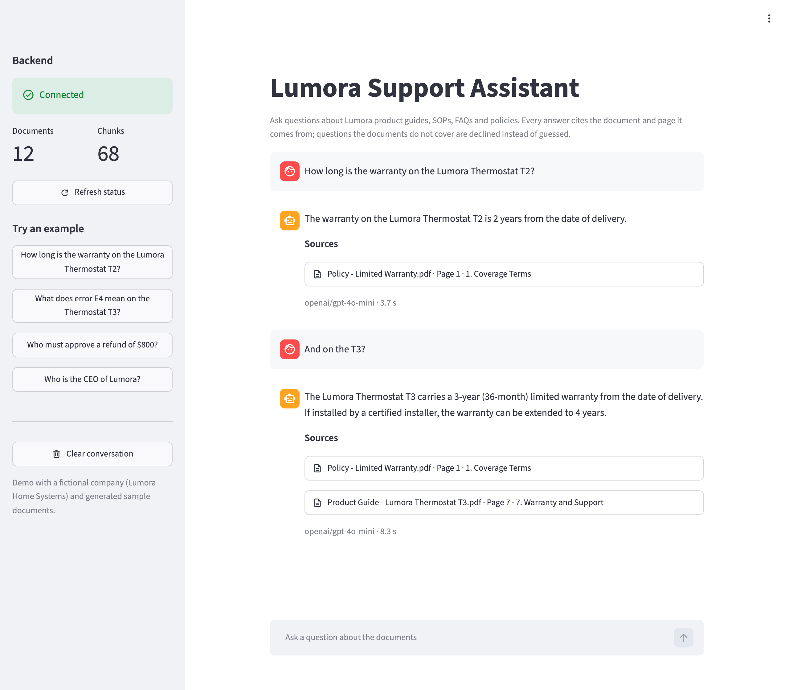
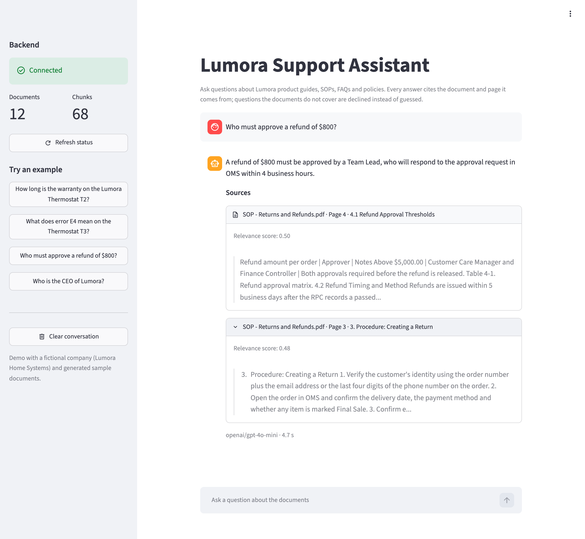
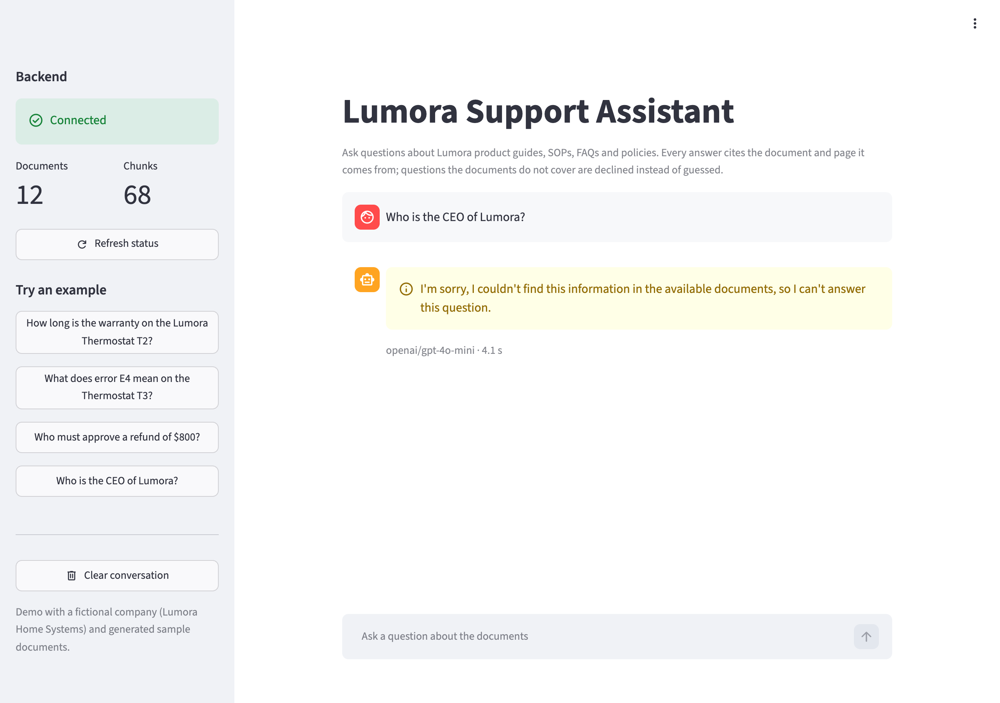
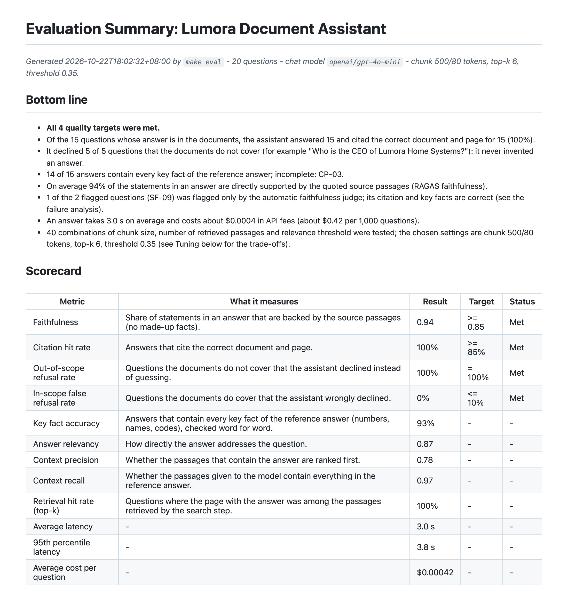
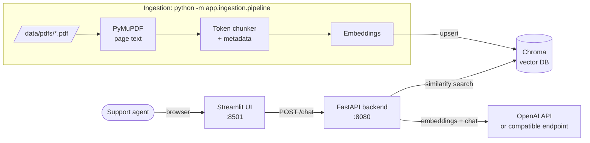

# RAG Document Assistant

A chatbot that answers questions from your PDF knowledge base, cites the exact document and
page for every answer, and says "I couldn't find this" instead of guessing when the
documents do not cover a question.

Built with Python, LangChain, OpenAI, ChromaDB, FastAPI, Streamlit and Docker. The demo ships
with 12 PDFs of a fictional smart-home company (Lumora Home Systems): product guides, SOPs,
FAQs and a warranty policy, about 63 pages in total.



**Highlights**

- **Citations you can trust.** The model only returns the IDs of the passages it used;
  document names and page numbers are added by code, so a citation can never point to a
  page that does not exist.
- **No made-up answers.** Out-of-scope questions are declined (100% on the evaluation set,
  0% false refusals on in-scope questions).
- **Measured, not guessed.** A 20-question evaluation with RAGAS and custom citation /
  refusal metrics; see [the evaluation summary](eval/reports/summary.md).
- **One command to run.** `docker compose up` starts the vector database, the API and the
  chat UI; data persists across restarts.

## Screenshots

| Citations, expanded | Declining an out-of-scope question |
|---|---|
|  |  |

The evaluation report (excerpt of [eval/reports/summary.md](eval/reports/summary.md)):



## Contents

- [Architecture](#architecture)
- [Quick start (Docker)](#quick-start-docker)
- [Use your own PDFs](#use-your-own-pdfs)
- [API](#api)
- [How hallucinations are prevented](#how-hallucinations-are-prevented)
- [Evaluation results](#evaluation-results)
- [Configuration](#configuration)
- [Local development (without Docker)](#local-development-without-docker)
- [Deployment](#deployment)
- [Switching the vector database](#switching-the-vector-database)
- [Cost estimate](#cost-estimate)
- [Project layout](#project-layout)
- [Limitations and next steps](#limitations-and-next-steps)

## Architecture



How a question is answered:

1. If the question is a follow-up ("what about the T3?"), it is rewritten into a standalone
   question using the recent chat history.
2. The question is embedded and the top 6 passages are retrieved from Chroma; passages with
   a similarity below 0.35 are dropped. If nothing is left, the assistant declines without
   calling the language model.
3. The remaining passages, each labelled with an ID, document name and page, are sent to the
   chat model, which returns a structured answer: `is_answerable`, `answer` and the IDs of
   the passages it used.
4. The code turns those IDs into citations (document, page, section, snippet, score).

Services in `docker-compose.yml`:

| Service | Image | Port | Purpose |
|---|---|---|---|
| `chroma` | `chromadb/chroma:1.5.9` | internal only | Vector database; data in the `chroma_data` volume |
| `api` | built from `docker/api.Dockerfile` | 8080 (localhost only) | FastAPI backend (`/chat`, `/health`, `/ingest`, `/docs`); also runs ingestion |
| `ui` | built from `docker/ui.Dockerfile` | 8501 | Streamlit chat UI; talks to the API over HTTP |

## Quick start (Docker)

Requirements: Docker with Compose v2 and an OpenAI API key.

```bash
git clone <this-repository-url> rag-document-assistant
cd rag-document-assistant
```

**1. Configure** - copy the example settings and set your key:

```bash
cp .env.example .env
# edit .env and set OPENAI_API_KEY=sk-...
```

Using OpenRouter or another OpenAI-compatible provider? Also set `OPENAI_BASE_URL` and the
model names in `.env` (see [Configuration](#configuration)); for OpenRouter that is
`OPENAI_BASE_URL=https://openrouter.ai/api/v1`, `OPENAI_CHAT_MODEL=openai/gpt-4o-mini` and
`OPENAI_EMBEDDING_MODEL=openai/text-embedding-3-small`.

**2. Start the stack** (the first build takes a few minutes):

```bash
docker compose up -d --build        # or: make up
docker compose ps                   # wait until api and ui show "(healthy)"
```

**3. Index the PDFs and open the UI:**

```bash
docker compose run --rm api python -m app.ingestion.pipeline   # or: make docker-ingest
```

Then open <http://localhost:8501> and ask, for example, *"How long is the warranty on the
Lumora Thermostat T2?"* or *"Who is the CEO of Lumora?"* (declined: not in the documents).

The ingestion prints a summary like `Files: 12 processed, 0 skipped`, `Chunks: 68` and the
number of chunks written. Indexing the sample documents costs well under one cent.

Useful commands:

```bash
docker compose logs -f api          # follow the API logs (JSON lines); or: make logs
curl http://localhost:8080/health   # {"status":"ok", ..., "chunk_count":68, "document_count":12}
docker compose down                 # stop; the index is kept in the chroma_data volume
docker compose down -v              # stop AND delete the index
```

Ports already in use? Set `API_PORT` / `UI_PORT` in your shell or in `.env` (for example
`UI_PORT=8601`) before `docker compose up`.

## Use your own PDFs

1. Put your PDFs into `data/pdfs/` (subfolders are fine). You can delete the sample PDFs
   and `FACTS.md`.
2. Re-run the ingestion:

   ```bash
   docker compose run --rm api python -m app.ingestion.pipeline
   ```

The ingestion is incremental and idempotent: unchanged files are skipped (no embedding cost),
changed files are re-indexed, and files removed from the folder are removed from the index.
To rebuild everything from scratch (for example after changing `CHUNK_SIZE_TOKENS`), add
`--reset`:

```bash
docker compose run --rm api python -m app.ingestion.pipeline --reset
```

Other useful flags: `--dry-run` (parse and chunk only, print statistics, no API calls) and
`--dry-run --sample 3` (also print 3 example chunks with their metadata).

Notes:

- `data/pdfs/` is mounted read-only into the API container, so no image rebuild is needed
  when documents change.
- The document type used in the metadata (`product_guide`, `sop`, `faq`, `policy`) is
  inferred from the file name or folder (e.g. `SOP - Returns.pdf` or `sops/Returns.pdf`).
- Scanned PDFs without a text layer are reported as skipped; they need OCR first.
- Re-indexing can also be triggered over HTTP with `POST /ingest` (see below).

## API

Interactive OpenAPI docs: <http://localhost:8080/docs>.

### `POST /chat`

```bash
curl -s http://localhost:8080/chat \
  -H "Content-Type: application/json" \
  -d '{"question": "Who must approve a refund of $800?"}'
```

```json
{
  "answer": "A refund of $800 must be approved by a Team Lead, who will respond to the approval request in OMS within 4 business hours.",
  "is_answerable": true,
  "sources": [
    {
      "document": "SOP - Returns and Refunds.pdf",
      "page": 4,
      "section": "4.1 Refund Approval Thresholds",
      "snippet": "Refund amount per order | Approver | Notes Above $5,000.00 | ...",
      "score": 0.5029,
      "chunk_id": "sop-returns-and-refunds__p4__c0"
    }
  ],
  "model": "gpt-4o-mini",
  "latency_ms": 2840
}
```

Follow-up questions: pass the previous turns in `history` (the most recent 6 turns are
used):

```bash
curl -s http://localhost:8080/chat \
  -H "Content-Type: application/json" \
  -d '{
        "question": "And on the T3?",
        "history": [
          {"role": "user", "content": "How long is the warranty on the Thermostat T2?"},
          {"role": "assistant", "content": "The Lumora Thermostat T2 has a 2-year limited warranty."}
        ]
      }'
```

A question the documents do not cover returns `"is_answerable": false`, a fixed refusal
message and no sources:

```bash
curl -s http://localhost:8080/chat \
  -H "Content-Type: application/json" \
  -d '{"question": "Who is the CEO of Lumora?"}'
```

Request rules: `question` is 1-2000 characters; `history` items have `role` `user` or
`assistant`. Invalid requests get HTTP 422. If the language model or the vector database is
unavailable the API answers 503 (502 for other model errors) with a short, safe message and
a `request_id`; every response carries an `X-Request-ID` header that also appears in the
logs.

### `GET /health`

```bash
curl -s http://localhost:8080/health
```

Returns 200 with the collection name and the number of indexed chunks and documents, or 503
if Chroma is unreachable. Docker uses it as the API health check.

### `POST /ingest` (admin)

Re-indexes `PDF_DIR` in the background. Disabled unless `ADMIN_API_KEY` is set in `.env`:

```bash
curl -s -X POST http://localhost:8080/ingest -H "X-Admin-Key: $ADMIN_API_KEY"
```

Returns 202 (started), 401 (wrong key), 403 (endpoint disabled) or 409 (already running).

## How hallucinations are prevented

Three independent safeguards, cheapest first:

1. **Relevance threshold.** Retrieved passages with a cosine similarity below
   `RETRIEVAL_SCORE_THRESHOLD` (0.35) are discarded. Small talk and clearly unrelated
   questions end here and are declined without a model call.
2. **Grounded, structured answer.** The prompt tells the model to use only the provided
   passages and to treat them as data, not instructions. The model must return
   `is_answerable` plus the IDs of the passages it relied on (structured output), and set
   `is_answerable=false` when the passages do not contain the answer.
3. **Citations built by code.** Only passage IDs that were actually sent in this request are
   accepted; they are mapped to file name, page and section by code. An answer that claims to
   be answerable but cites no valid passage is turned into a refusal.

Refusals always use the same message ("I'm sorry, I couldn't find this information in the
available documents ...") and may name related documents, so a support agent knows where
to look.

## Evaluation results

20 questions (10 single facts, 3 cross-page or table facts, 2 easily confused T2-vs-T3
facts, 5 questions the documents do not answer), scored with RAGAS and custom metrics:

| Metric | Result | Target |
|---|---|---|
| Faithfulness (RAGAS) | 0.94 | >= 0.85 |
| Citation hit rate (correct document and page) | 100% | >= 85% |
| Out-of-scope questions declined | 100% | 100% |
| In-scope questions wrongly declined | 0% | <= 10% |
| Average latency / cost per question | 3.0 s / $0.0004 | - |

The full report, written for non-technical readers, with per-question results, failure
analysis and the parameter tuning (40 combinations of chunk size, top-k and threshold), is in
[eval/reports/summary.md](eval/reports/summary.md).

To re-run it (real API calls, about 20 questions plus RAGAS judging), use the local setup
below and run `make eval`.

## Configuration

All settings are read from `.env` (see [.env.example](.env.example)); real environment
variables override `.env`. In Docker, `docker-compose.yml` fixes `CHROMA_MODE=http`,
`CHROMA_HOST=chroma`, `CHROMA_PORT=8000`, `PDF_DIR=/app/data/pdfs` and the UI's
`API_BASE_URL`.

| Variable | Default | Description |
|---|---|---|
| `OPENAI_API_KEY` | (required) | API key for the chat and embedding models |
| `OPENAI_BASE_URL` | `https://api.openai.com/v1` | Any OpenAI-compatible endpoint (e.g. OpenRouter `https://openrouter.ai/api/v1`, Azure OpenAI proxy) |
| `OPENAI_CHAT_MODEL` | `gpt-4o-mini` | Chat model (OpenRouter: `openai/gpt-4o-mini`) |
| `OPENAI_EMBEDDING_MODEL` | `text-embedding-3-small` | Embedding model (OpenRouter: `openai/text-embedding-3-small`) |
| `OPENAI_EMBEDDING_BASE_URL` | (blank = same as chat) | Separate endpoint for embeddings |
| `OPENAI_EMBEDDING_API_KEY` | (blank = same as chat) | Separate key for embeddings |
| `OPENAI_TIMEOUT_SECONDS` | `30` | Timeout per chat model request |
| `OPENAI_MAX_RETRIES` | `2` | Automatic retries with backoff |
| `CHROMA_MODE` | `local` | `local` (embedded, files in `CHROMA_PERSIST_DIR`) or `http` (Chroma server) |
| `CHROMA_PERSIST_DIR` | `./.chroma` | Index folder for `local` mode |
| `CHROMA_HOST` / `CHROMA_PORT` | `chroma` / `8000` | Chroma server for `http` mode |
| `CHROMA_COLLECTION` | `company_docs` | Collection name |
| `PDF_DIR` | `./data/pdfs` | Folder that is indexed |
| `CHUNK_SIZE_TOKENS` | `500` | Chunk size (re-ingest with `--reset` after changing) |
| `CHUNK_OVERLAP_TOKENS` | `80` | Overlap between consecutive chunks |
| `RETRIEVAL_TOP_K` | `6` | Passages retrieved per question |
| `RETRIEVAL_SCORE_THRESHOLD` | `0.35` | Minimum similarity (0-1) for a passage to be used |
| `RAG_MAX_CONTEXT_TOKENS` | `3000` | Token budget for passages sent to the model |
| `RAG_HISTORY_MAX_TURNS` | `6` | Recent conversation turns used for follow-up questions |
| `API_BASE_URL` | `http://localhost:8080` | API URL used by the UI |
| `UI_REQUEST_TIMEOUT_SECONDS` | `120` | How long the UI waits for an answer |
| `API_CORS_ORIGINS` | `http://localhost:8501` | Comma-separated browser origins allowed to call the API (`*` = any) |
| `ADMIN_API_KEY` | (blank = disabled) | Key for `POST /ingest` (`X-Admin-Key` header) |
| `LOG_LEVEL` | `INFO` | `DEBUG`, `INFO`, `WARNING`, `ERROR`, `CRITICAL` |
| `API_PORT` / `UI_PORT` | `8080` / `8501` | Host ports published by Docker Compose |

Check that your endpoint and models work before indexing:

```bash
docker compose run --rm api python -m scripts.check_llm_endpoint   # or locally: make check-llm
```

## Local development (without Docker)

Requires Python 3.11. The local setup uses an embedded Chroma index in `./.chroma`.

```bash
make install                 # create .venv and install pinned dependencies
cp .env.example .env         # set OPENAI_API_KEY (keep CHROMA_MODE=local)
make ingest                  # index data/pdfs
make api                     # terminal 1: API on http://127.0.0.1:8080
make ui                      # terminal 2: UI on http://localhost:8501
```

Quality checks and tooling:

```bash
make lint                    # ruff lint + format check
make test                    # unit tests (no API calls; integration tests excluded)
make eval                    # evaluation -> eval/reports/ (real API calls)
make help                    # all targets
```

## Deployment

### A single VPS with Docker Compose (recommended)

Any small Linux VM works (2 vCPU / 2-4 GB RAM is plenty for tens of thousands of chunks):

```bash
# on the server (Docker and the compose plugin installed)
git clone <this-repository-url> rag-document-assistant && cd rag-document-assistant
cp .env.example .env && nano .env          # OPENAI_API_KEY, optionally ADMIN_API_KEY
docker compose up -d --build
docker compose run --rm api python -m app.ingestion.pipeline
```

Then put a reverse proxy with HTTPS in front of the UI, for example Caddy
(`/etc/caddy/Caddyfile`):

```
assistant.example.com {
    basic_auth {
        # generate the hash with: caddy hash-password
        demo <bcrypt-hash>
    }
    reverse_proxy localhost:8501
}
```

Recommendations for a public deployment:

- Only expose the UI (through the proxy). The API is already published on `127.0.0.1`
  only (`/chat` has no authentication and spends API credits); the UI reaches it over the
  internal compose network. To call the API from other machines, put it behind the proxy
  with authentication rather than changing the port binding.
- Protect the UI with a password (basic auth above) or your SSO, and set a monthly usage
  limit on the OpenAI key.
- All services use `restart: unless-stopped`, so they come back after a reboot; the index
  survives in the `chroma_data` volume. Back it up with
  `docker run --rm -v rag-document-assistant_chroma_data:/data -v "$PWD":/backup busybox tar czf /backup/chroma.tgz -C /data .`

### Render / Railway (optional)

Both platforms can run the two images from this repository:

- Create three services: Chroma (image `chromadb/chroma:1.5.9` with a persistent disk
  mounted at `/data`), the API (`docker/api.Dockerfile`) and the UI (`docker/ui.Dockerfile`).
- API environment: everything from `.env` plus `CHROMA_MODE=http`, `CHROMA_HOST` /
  `CHROMA_PORT` pointing to the Chroma service's private address.
- UI environment: `API_BASE_URL` set to the API's private URL.
- Index the documents once with a one-off job or shell in the API service:
  `python -m app.ingestion.pipeline` (the PDFs must be in `PDF_DIR`, e.g. on a mounted disk
  or baked into a custom image).

## Switching the vector database

All vector store access goes through `app/retrieval/vectorstore.py`
(`get_vectorstore()` returns a LangChain vector store), so moving to Qdrant or pgvector is a
contained change:

1. Add the LangChain integration (`langchain-qdrant` or `langchain-postgres`) to
   `pyproject.toml` and run `make lock`.
2. In `get_vectorstore()`, build `QdrantVectorStore` / `PGVector` instead of `Chroma`, with
   **cosine** distance, from new settings (e.g. `QDRANT_URL`, `PG_CONNECTION`).
3. Scores: the retriever converts Chroma's cosine *distance* to a 0-1 similarity in
   `distance_to_similarity()` (`app/retrieval/retriever.py`). Qdrant already returns cosine
   similarity, so the conversion becomes the identity; check the scale with
   `make check-retrieval` and re-validate `RETRIEVAL_SCORE_THRESHOLD` with `make eval`.
4. The ingestion uses `add_documents(ids=...)` (upsert by chunk ID), `get()` and `delete()`;
   replace the Chroma-specific `get()` / collection count calls in
   `app/ingestion/pipeline.py` and `app/api/service.py` with the equivalent of the new store.
5. Replace the `chroma` service in `docker-compose.yml` (e.g. `qdrant/qdrant` or
   `pgvector/pgvector`) and re-run the ingestion with `--reset`.

The chunk metadata (`chunk_id`, `source`, `page`, `section`, ...) and the API contract do not
change.

## Cost estimate

Prices: `text-embedding-3-small` $0.02 per 1M tokens; `gpt-4o-mini` $0.15 per 1M input and
$0.60 per 1M output tokens (OpenAI list prices; check the current pricing page).

| Item | Estimate |
|---|---|
| Indexing the 12 sample PDFs (63 pages, ~24k tokens) | < $0.001 |
| Indexing 80 PDFs of ~20 pages each (~1,600 pages, ~1M tokens) | about $0.02 |
| Re-indexing unchanged files | $0 (skipped) |
| One question with `gpt-4o-mini` (measured in the evaluation) | about $0.0004 |
| 1,000 questions with `gpt-4o-mini` | about $0.40 |
| 1,000 questions with `gpt-4o` (about 16x the price of `gpt-4o-mini`) | about $7 |

Hosting: a small VPS ($5-20 per month) runs the whole stack. Costs are dominated by the
number of questions and the chosen chat model, not by the number of documents.

## Project layout

```
app/
  config.py              settings (pydantic-settings, reads .env)
  ingestion/             PDF loading (PyMuPDF), token chunking, CLI pipeline
  retrieval/             Chroma client factory, scored retrieval + threshold
  rag/                   prompts, structured output schema, answer_question()
  api/                   FastAPI app, request/response schemas, service wiring
ui/streamlit_app.py      chat UI (HTTP client of the API)
data/pdfs/               sample PDFs (fictional company) + FACTS.md
eval/                    questions.yaml, evaluation runner, reports/
scripts/                 sample PDF generator, endpoint and retrieval checks
tests/                   unit tests (pytest; OpenAI is mocked)
docker/                  api.Dockerfile, ui.Dockerfile
docker-compose.yml       chroma + api + ui
```

## Limitations and next steps

Known limitations of this demo, and what a production rollout would add:

- **Tables that span two pages.** Chunks never cross a page boundary, so a table that
  continues on the next page is split in two. In the evaluation this occasionally drops a
  row from an answer (CP-03) or cites the continuation page instead of the first page.
  Next step: table-aware chunking that merges a table across pages.
- **Scanned PDFs.** Pages without a text layer are skipped and reported; scanned documents
  need OCR (e.g. Tesseract or a cloud OCR service) before ingestion.
- **Re-indexing after a settings change.** Incremental ingestion compares file hashes and
  chunk IDs, so after changing the chunk size, the overlap or the embedding model run the
  ingestion with `--reset`.
- **Short chunks near the threshold.** Some correct passages score just above the 0.35
  relevance threshold (about 0.36-0.41). Raising the threshold for a new document set should
  always be validated with `make eval`, otherwise in-scope questions start being declined.
- **Evaluation judge.** RAGAS faithfulness is judged by the same small model by default
  (`gpt-4o-mini`) and occasionally flags a correct answer (SF-09). Use a stronger judge with
  `python -m eval.run_eval --judge-model <model>` for sign-off runs.
- **Authentication.** The UI and `/chat` have no user accounts. Public deployments should
  sit behind a password or SSO proxy (see [Deployment](#deployment)) with a spending limit on
  the API key; per-user rate limiting is a natural next step.
- **Image size.** The API image (about 1.2 GB) includes the full `chromadb` package, which
  also supports the local mode. A slimmer image could use `chromadb-client` for the Docker
  setup.
- **Hyphenated line breaks.** A compound word broken at a line end with its own hyphen
  (`self-` / `service`) is joined as `selfservice`; this does not occur in the sample
  documents.

Possible extensions: streaming answers, hybrid search (BM25 + vectors) and a reranker for
large document sets, per-document access control, feedback buttons in the UI, and a
scheduled ingestion job that watches a shared drive or S3 bucket.
